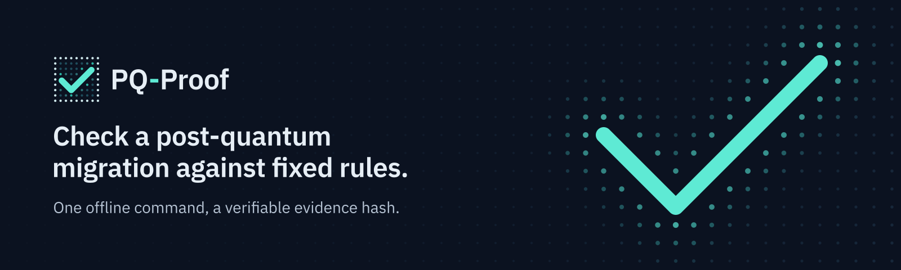

<p align="center">
  <a href="https://g1mn.github.io/pqproof/?lang=ko">
    
  </a>
</p>

<p align="center"><a href="https://github.com/g1mn/pqproof/blob/main/README.md">English</a> · <b>한국어</b></p>

<p align="center">
  <a href="https://github.com/g1mn/pqproof/actions/workflows/ci.yml"></a>
  <a href="https://github.com/g1mn/pqproof/releases"></a>
  <a href="https://pypi.org/project/pqproof/"></a>
  <a href="https://github.com/g1mn/pqproof/blob/main/LICENSE"></a>
  <a href="https://scorecard.dev/viewer/?uri=github.com/g1mn/pqproof"></a>
  <a href="https://www.bestpractices.dev/projects/16982"></a>
  <a href="https://g1mn.github.io/pqproof/?lang=ko"></a>
</p>

<p align="center">
  <b>PQC 전환이 끝났는지 오프라인으로 확인하고, 누구나 다시 계산할 수 있는 검증 증적을 남깁니다.</b><br>
  전환 전 코드와 후 코드를 같은 규칙으로 판정하며, 판정에 AI 모델을 쓰지 않습니다. KpqC 구현도 실행하지 않고 고정한 참조판 KAT와 대조합니다.
</p>

---

### [자세한 내용은 모두 사이트에 있습니다: g1mn.github.io/pqproof](https://g1mn.github.io/pqproof/?lang=ko)
> 사용법, 판정 기준, 공개 시험 결과, KpqC 구현 검증, PQC 기준 대응표(NIST IR 8547, 2026 시범전환 공모안내서, 발간되면 KISA 가이드), KISA AI 보안 위협 대응 매뉴얼 대응표, 한계, 릴리스 기록을 한국어와 영어로 볼 수 있습니다. 대회 참가자가 만든 도구이며, 과학기술정보통신부와 KISA가 검토하거나 보증하지 않았습니다.

---

## 빠른 시작

```bash
pip install pqproof
pqproof doctor                       # 찾은 것과 빠진 것을 보여 줌
ex=$(pqproof examples)               # 번들 예제(전환 전·후 트리)
pqproof "$ex/classic" "$ex/pqc"       # 해 보기: RSA·ECDSA를 ML-KEM-768·ML-DSA-65로 바꾼 판, 통과
pqproof <original> <converted>       # 내 두 트리를 판정하고 검증 증적 폴더를 씀
pqproof --verify <output folder>     # 증적 해시와 모든 파일 해시를 다시 계산
FAIL_ON_REVIEW=1 pqproof impl judge answers.json   # KpqC 구현 검증
```

안내 문서(기여 방법 말고는 영어): [빠른 시작](https://github.com/g1mn/pqproof/blob/main/guide/quickstart.md) · [설정](https://github.com/g1mn/pqproof/blob/main/guide/configuration.md) · [허용 목록](https://github.com/g1mn/pqproof/blob/main/guide/allowlist.md) · [출력](https://github.com/g1mn/pqproof/blob/main/guide/outputs.md) · [CI](https://github.com/g1mn/pqproof/blob/main/guide/ci.md) · [구현 검증](https://github.com/g1mn/pqproof/blob/main/guide/impl.md) · [설계](https://github.com/g1mn/pqproof/blob/main/DESIGN.md) · [대회 이야기](https://github.com/g1mn/pqproof/blob/main/HISTORY.md) · [변경 기록](https://github.com/g1mn/pqproof/blob/main/CHANGELOG.md) · [기여 방법](https://github.com/g1mn/pqproof/blob/main/CONTRIBUTING.ko.md) · [로드맵](https://github.com/g1mn/pqproof/blob/main/ROADMAP.md) · [기준 대응표](https://github.com/g1mn/pqproof/tree/main/mappings) · [보안 신고](https://github.com/g1mn/pqproof/blob/main/SECURITY.md)

<p align="center"></p>

## 기여

이슈, 풀 리퀘스트, 대응표 정정을 환영합니다. [처음 기여하기 좋은 이슈](https://github.com/g1mn/pqproof/contribute)부터 보세요. 대응표 정정은 PQC 전환 경험만으로 할 수 있고, 어디서든 영어로 써도 됩니다.

로컬 확인 방법은 [CONTRIBUTING.ko.md](https://github.com/g1mn/pqproof/blob/main/CONTRIBUTING.ko.md)와 [행동 강령](https://github.com/g1mn/pqproof/blob/main/CODE_OF_CONDUCT.md)을 보세요.

## 관련 저장소

[PQ-Proof Agent](https://github.com/g1mn/pq-proof)(`g1mn/pq-proof`, Vultr Agent Rush 출품작)는 전환을 실행하는 AI 에이전트이고, 이 저장소는 오프라인 검증 도구입니다. [pq-verify](https://pypi.org/project/pq-verify/)는 NIST PQC 라이브러리를 감사하는 도구이며, `pqproof impl judge --pq-verify`를 쓰면 그 감사 결과가 같은 증적에 들어갑니다.

## 라이선스

MIT © 2026 [g1mn](https://github.com/g1mn)

사이트와 그 데이터에 실린 「AI 보안 위협 대응 매뉴얼」(과학기술정보통신부·KISA) 인용문은 MIT가 아니라 공공누리 제4유형(출처표시, 상업적 이용금지, 변경금지)을 따릅니다. `mappings/`에 실린 공개 문서의 짧은 인용도 MIT 대상이 아니며, 파일마다 출처를 적었습니다. docs/index.html에 넣은 글꼴은 SIL Open Font License 1.1을 따르고, 라이선스 원문은 페이지에 있습니다.
